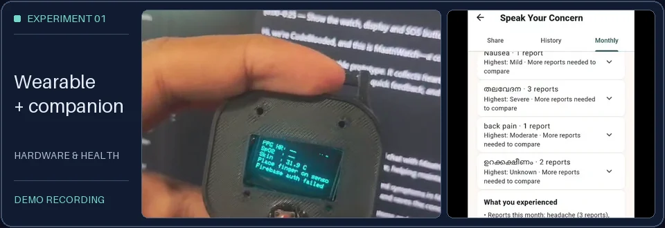
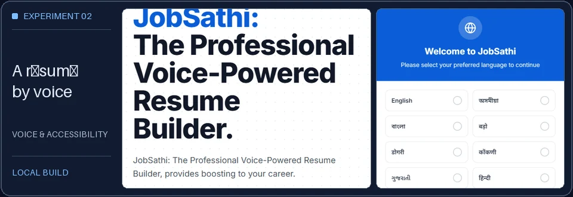
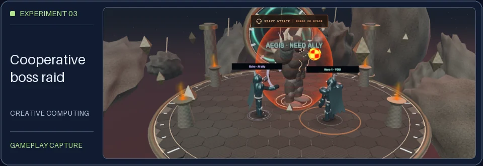
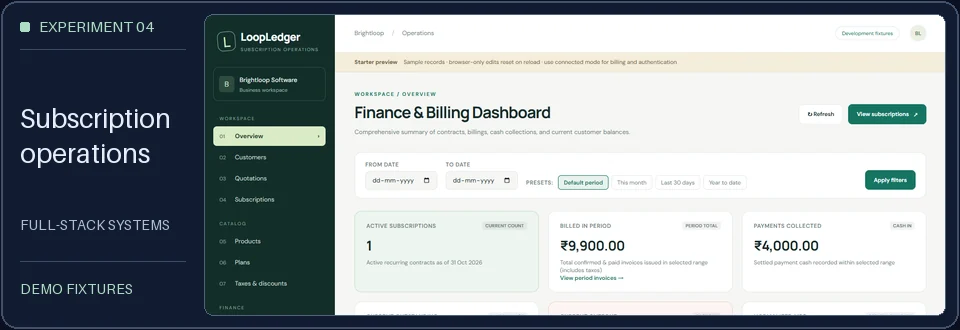
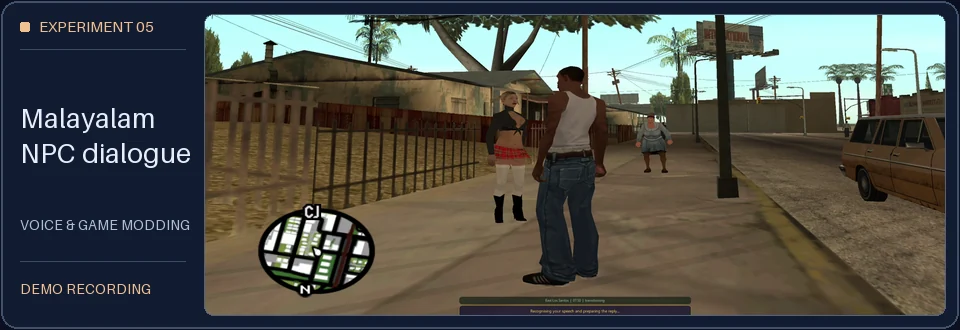

<picture>
  <source media="(prefers-reduced-motion: reduce) and (max-width: 600px)" srcset="assets/name-grid/mobile-static.svg">
  <source media="(prefers-reduced-motion: reduce)" srcset="assets/name-grid/desktop-static.svg">
  <source media="(max-width: 600px)" srcset="assets/name-grid/mobile.svg">
  
</picture>

# Building things I wish existed.

I’m **Devadathan M R**, or Dathan, a Computer Science & Engineering (Data Science) undergraduate at Mar Athanasius College of Engineering, Kothamangalam. I learn by building things I can put in someone’s hands, from a maternal-care wearable to a résumé builder that starts with a conversation.

Kerala, India · [Explore my work](#selected-experiments) · [LinkedIn](https://www.linkedin.com/in/devadathanmr)

## Selected experiments

### 01 · MaatriWatch

**Hardware & health** · A maternal-care prototype for keeping patient concerns and wearable readings available for clinician follow-up.

<picture>
  <source media="(max-width: 600px)" srcset="assets/projects/maatriwatch-mobile.webp">
  
</picture>

I worked on the team’s hardware and backend, including authenticated ESP32 telemetry and the pipeline that separates live updates from stored records.

`ESP32` `Flutter` `Flask` `PostgreSQL` · [Repository ↗](https://github.com/Devadathan69/MaatriWatch) · [Recorded demo ↗](https://github.com/Devadathan69/MaatriWatch#product-demo)

### 02 · JobSathi

**Voice & accessibility** · A résumé builder and job search for people who prefer speaking to filling out forms.

<picture>
  <source media="(max-width: 600px)" srcset="assets/projects/jobsathi-mobile.webp">
  
</picture>

Our team connected Indic speech recognition to English translation and PDF generation. I contributed to the frontend.

`React` `FastAPI` `AI4Bharat` `Gemini` · [Repository ↗](https://github.com/Devadathan69/jobsathi) · [My frontend contribution ↗](https://github.com/mathew1046/jobsathi/commit/128146a)

### 03 · GhostWire

**Creative computing** · A cooperative browser raid where a squad times attacks to break a boss’s shield.

<picture>
  <source media="(max-width: 600px)" srcset="assets/projects/ghostwire-mobile.webp">
  
</picture>

Socket.IO keeps the raid state in sync across devices. Camera gestures map to combat actions alongside keyboard and touch controls.

`TypeScript` `Three.js` `Socket.IO` `MediaPipe` · [Repository ↗](https://github.com/Devadathan69/GhostWire) · [Recorded gameplay ↗](https://github.com/Devadathan69/GhostWire#demo-video)

### 04 · LoopLedger

**Full-stack systems** · A workspace that follows a subscription from its first quote through invoices and payments.

<picture>
  <source media="(max-width: 600px)" srcset="assets/projects/loopledger-mobile.webp">
  
</picture>

I worked on the team’s core platform and billing services. Contracts snapshot prices, and invoice generation runs in a transaction to prevent duplicate billing.

`Next.js` `TypeScript` `PostgreSQL` · [Repository ↗](https://github.com/Devadathan69/make-a-ton) · [Hosted demo · sign-in required ↗](https://loopledger-demo.vercel.app/dashboard)

### 05 · Malayalam NPC Companion

**Voice & game modding** · A local GTA San Andreas prototype that lets players speak to pedestrians in Malayalam.

<picture>
  <source media="(max-width: 600px)" srcset="assets/projects/devdayhack-mobile.webp">
  
</picture>

A native C++ adapter connects push-to-talk and in-game subtitles to a dialogue pipeline that can use the player’s location, game clock, and weather.

`C++` `Node.js` `SQLite` `OpenAI` `ElevenLabs` · [Repository ↗](https://github.com/Devadathan69/DevDayHack) · [Recorded demo · 329 MB ↗](https://github.com/Devadathan69/DevDayHack/blob/main/demo/demo.mp4)

## Milestones

| Recognition | Work |
| :--- | :--- |
| **Hardware Winner** · Hackatly 4.0 | MaatriWatch with Team CodeBlooded. [Organizer results ↗](https://iedc-tly.github.io/Hackatly4.0/) |
| **i-Hack finalist** · IIT Bombay, 2025 | JobSathi with Team Arrakis. |
| **Local Lead** · NASA Space Apps Challenge, 2026 | Led the [Kothamangalam event ↗](https://www.spaceappschallenge.org/2026/local-events/kothamangalam/). |
| **Student Branch Chapter with Best Website** · IEEE IAS, 2026 | Built the chapter’s site as webmaster. The award went to the MACE IAS chapter. [IEEE results ↗](https://ias.ieee.org/wp-content/uploads/2026/06/2026-Outstanding-Chapter-Awards-1.pdf) |

## Experience

### KeyValue Software Systems

FULL-STACK DEVELOPER INTERN · STARTED 2025

Built React pages for Netra’s admin dashboard and worked on agents for internal automation and product workflows with Claude Agent SDK, LangGraph, and OpenAI Agents SDK.

### ComputerValley IT Solutions

SOFTWARE DEVELOPER INTERN · 2025

Prototyped a Gemini workflow that turned product requirements into tasks and suggested assignees using skills and project history. Built with Python, Flask, and Streamlit.

## The Toolkit

| Capability | Tools I reach for |
| :--- | :--- |
|  **AI & agents** | LangGraph · Claude Agent SDK · OpenAI Agents SDK · TFLite |
|  **Full-stack engineering** | TypeScript · React · Next.js · Node.js · Python · FastAPI · Flask |
|  **Mobile development** | Flutter · Dart |
|  **Embedded & IoT** | ESP32 · Arduino · sensor telemetry |
|  **Data & infrastructure** | PostgreSQL · SQLite · Git · GitHub Actions |

## Inside the lab

Some days it’s getting a sensor to talk to a dashboard. Other days it’s getting a game character to speak Malayalam. Either way, I like getting a prototype in front of someone early enough to see what I missed.

## Comet Atlas

<picture>
  <source media="(prefers-reduced-motion: reduce) and (max-width: 600px)" srcset="assets/comet-atlas/mobile-static.svg">
  <source media="(prefers-reduced-motion: reduce)" srcset="assets/comet-atlas/desktop-static.svg">
  <source media="(max-width: 600px)" srcset="assets/comet-atlas/mobile.svg">
  
</picture>

One tile per day from the public GitHub contribution calendar. The calendar refreshes on a schedule. [View the calendar](https://github.com/Devadathan69?tab=overview#js-contribution-activity-description) · [Visual sources and maintenance](docs/VISUALS.md)

## Connect

If you’re building a prototype with a tricky workflow or a piece of hardware in the loop, I’d love to hear about it.

[GitHub](https://github.com/Devadathan69) · [LinkedIn](https://www.linkedin.com/in/devadathanmr) · [X](https://x.com/devadathan_69) · [Email](mailto:devadathanappu69@gmail.com)
