**Full-stack developer · Applied AI**

I build web apps for subscription billing and AI-assisted review. I get a working demo in front of people early so they can show me what needs to change.

[Browse repositories ↗](https://github.com/Devadathan69?tab=repositories)

## GitHub activity

<!-- public-activity:start -->

Public streaks · **2d** current · **9d** longest

<!-- public-activity:end -->

<picture>
  <source media="(max-width: 600px)" srcset="assets/comet-atlas-mobile.svg">
  
</picture>

## Stack

- **Web** · TypeScript, React, Next.js
- **Backend & data** · Node.js, Python, PostgreSQL
- **Mobile** · Flutter, Dart
