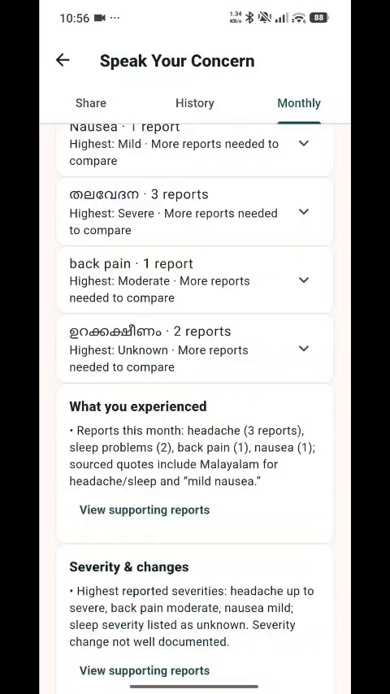

<picture>
  <source media="(prefers-reduced-motion: reduce) and (max-width: 600px)" srcset="assets/name-grid/mobile-static.svg">
  <source media="(prefers-reduced-motion: reduce)" srcset="assets/name-grid/desktop-static.svg">
  <source media="(max-width: 600px)" srcset="assets/name-grid/mobile.svg">
  
</picture>

# Building things I wish existed.

I’m **Devadathan M R**, or Dathan, a third-year Computer Science & Engineering (Data Science) student at Mar Athanasius College of Engineering, Kothamangalam (2024–2028). I learn by building full-stack and mobile apps, AI agents, and embedded prototypes, often under a hackathon deadline.

Kerala, India · [Repositories](https://github.com/Devadathan69?tab=repositories) · [LinkedIn](https://www.linkedin.com/in/devadathanmr)

## Selected experiments

### 01 · MaatriWatch

A team-built maternal-care prototype for clinician follow-up. I worked on hardware and backend, including authenticated ESP32 telemetry and the pipeline that separates live updates from stored patient records.

`ESP32` `Flutter` `Flask` `PostgreSQL` · [Source](https://github.com/Devadathan69/MaatriWatch) · [Recorded demo](https://github.com/Devadathan69/MaatriWatch#product-demo)

  
See the patient app

  

### 02 · LoopLedger

A team-built workspace for quotes, subscriptions, and payments. I worked on the core platform and billing services, including contract price snapshots and transactional invoice generation to prevent duplicate billing.

`Next.js` `TypeScript` `PostgreSQL` · [Source](https://github.com/Devadathan69/make-a-ton) · [Hosted demo (sign-in required)](https://loopledger-demo.vercel.app/)

### 03 · JobSathi

A voice-first résumé builder and job search for people who prefer speaking to filling out forms. Our team connected Indic speech recognition to English translation and PDF generation. I contributed to the frontend.

`React` `FastAPI` `AI4Bharat` `Gemini` · [Project source](https://github.com/mathew1046/jobsathi) · [My frontend change](https://github.com/mathew1046/jobsathi/commit/128146a)

### 04 · SentinelOS

A hackathon prototype for coordinating incident response. Agents exchange events through a publish-and-subscribe bus, a person approves proposed missions, and a simulated edge mode demonstrates what can still run when the connection drops.

`React` `FastAPI` `Gemini` · [Source](https://github.com/Devadathan69/SentinelOS)

### 05 · Malayalam NPC Companion

A local GTA San Andreas prototype that lets players speak to pedestrians in Malayalam. A native adapter connects push-to-talk and subtitles to a voice pipeline that uses the game’s current location, clock, and weather.

`C++` `Node.js` `SQLite` `OpenAI` `ElevenLabs` · [Source](https://github.com/Devadathan69/DevDayHack) · [Recorded demo (329 MB)](https://github.com/Devadathan69/DevDayHack/blob/main/demo/demo.mp4)

## Experience

- **KeyValue Software Systems** · Full-Stack Developer Intern (started 2025). Built React pages for Netra’s admin dashboard and worked on agents for internal automation and product use cases with Claude Agent SDK, LangGraph, and OpenAI Agents SDK.
- **ComputerValley IT Solutions** · Software Developer Intern (2025). Prototyped a Gemini workflow that turned product requirements into tasks and suggested assignees using skills and project history. Worked in Python, Flask, and Streamlit.

## Milestones

- **Hardware Winner, Hackatly 4.0** · Team CodeBlooded. [Organizer results](https://iedc-tly.github.io/Hackatly4.0/)
- **i-Hack finalist at IIT Bombay** · Team Arrakis, with JobSathi.
- **Local Lead, NASA Space Apps Challenge 2026** · [Kothamangalam event](https://www.spaceappschallenge.org/2026/local-events/kothamangalam/)
- **Webmaster, IEEE MACE Student Branch** · Built the IAS chapter website. The chapter received the 2026 IEEE IAS **Student Branch Chapter with Best Website** award. [IEEE results](https://ias.ieee.org/wp-content/uploads/2026/06/2026-Outstanding-Chapter-Awards-1.pdf)

## Toolkit

- **Web and data** · TypeScript, React, Next.js, Node.js, Python, Flask, FastAPI, PostgreSQL
- **Mobile and embedded** · Flutter, Dart, ESP32, Arduino, sensor telemetry
- **Applied AI** · LangGraph, Claude Agent SDK, OpenAI Agents SDK, TFLite, multilingual speech

## Inside the lab

I like projects that leave the browser. That might mean getting a sensor reading into a dashboard or getting a game character to respond in the language I speak at home.

## Comet Atlas

<picture>
  <source media="(prefers-reduced-motion: reduce) and (max-width: 600px)" srcset="assets/comet-atlas/mobile-static.svg">
  <source media="(prefers-reduced-motion: reduce)" srcset="assets/comet-atlas/desktop-static.svg">
  <source media="(max-width: 600px)" srcset="assets/comet-atlas/mobile.svg">
  
</picture>

One tile per day from the public GitHub contribution calendar. The calendar refreshes on a schedule. [View the calendar](https://github.com/Devadathan69#js-contribution-activity) · [Visual sources and maintenance](docs/VISUALS.md)

## Connect

If you’re building a prototype with a tricky workflow or a piece of hardware in the loop, I’d love to hear about it.

[GitHub](https://github.com/Devadathan69) · [LinkedIn](https://www.linkedin.com/in/devadathanmr) · [X](https://x.com/devadathan_69) · [Email](mailto:devadathanappu69@gmail.com)
