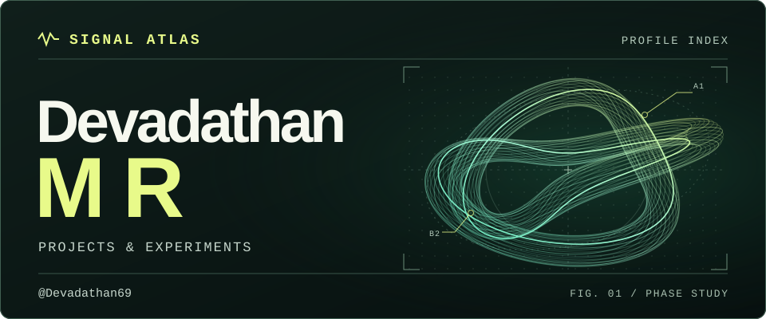

I build full-stack tools, applied AI prototypes, and interactive web experiences.

## Selected work

### `01` GhostWire

A co-op 3D boss raid in the browser. Use body movements to control your hero and coordinate attacks with friends.

[Watch the demo ↗](https://github.com/Devadathan69/GhostWire#demo-video) · [Source code](https://github.com/Devadathan69/GhostWire)

### `02` LoopLedger

From quote to recurring invoice. A subscription workspace that shows how each charge was calculated and tracks what’s been paid.

[Try the live demo ↗](https://loopledger-demo.vercel.app/) · [Source code](https://github.com/Devadathan69/make-a-ton)

### `03` MaatriWatch

A team prototype for maternal-care follow-up that brings wearable readings, symptom notes, and clinician review into one workflow.

[Watch the product demo ↗](https://github.com/Devadathan69/MaatriWatch#product-demo) · [Source code](https://github.com/Devadathan69/MaatriWatch)

---

**Tools I work with** · TypeScript, React, Next.js, Three.js, Python, PostgreSQL

[Browse all repositories →](https://github.com/Devadathan69?tab=repositories)
