<picture>
  <source media="(prefers-reduced-motion: reduce) and (max-width: 600px)" srcset="assets/name-grid/mobile-static.svg">
  <source media="(prefers-reduced-motion: reduce)" srcset="assets/name-grid/desktop-static.svg">
  <source media="(max-width: 600px)" srcset="assets/name-grid/mobile.svg">
  
</picture>

# Building things I wish existed.

I’m **Devadathan M R** (Dathan), a Computer Science & Engineering (Data Science) undergraduate at Mar Athanasius College of Engineering, Kothamangalam. I build AI agents and full-stack apps, and I like seeing what happens when software meets a sensor, a circuit, or a game.

## The Toolkit

<picture>
  <source media="(prefers-reduced-motion: reduce) and (max-width: 820px)" srcset="assets/toolkit/mobile-static.svg">
  <source media="(prefers-reduced-motion: reduce)" srcset="assets/toolkit/desktop-static.svg">
  <source media="(max-width: 820px)" srcset="assets/toolkit/mobile.svg">
  
</picture>

Toolkit as text

- **Languages** · Python, JavaScript, TypeScript, Java, C, Dart
- **Frontend & backend** · React, Next.js, Node.js, FastAPI, Flask
- **AI & agents** · LangGraph, Claude Agent SDK, OpenAI Agents SDK, TensorFlow Lite
- **Mobile & embedded** · Flutter, ESP32, Arduino
- **Databases & tools** · PostgreSQL, SQLite, Firebase, Supabase, Git, GitHub, Figma

## Inside the Lab

Some days I’m getting a sensor to talk to a dashboard. Other days I’m getting a game character to speak Malayalam.

## Comet Atlas

<picture>
  <source media="(prefers-reduced-motion: reduce) and (max-width: 600px)" srcset="assets/comet-atlas/mobile-static.svg">
  <source media="(prefers-reduced-motion: reduce)" srcset="assets/comet-atlas/desktop-static.svg">
  <source media="(max-width: 600px)" srcset="assets/comet-atlas/mobile.svg">
  
</picture>

One tile per day from the public GitHub contribution calendar. The calendar refreshes on a schedule. [View the calendar](https://github.com/Devadathan69?tab=overview#js-contribution-activity-description) · [Visual sources and maintenance](docs/VISUALS.md)

## Send a Signal

Building something interesting? I’d love to hear about it.

  <picture>
    <source media="(prefers-reduced-motion: reduce)" srcset="assets/contact/beacon-static.svg">
    
  </picture>

  &nbsp;
  &nbsp;

