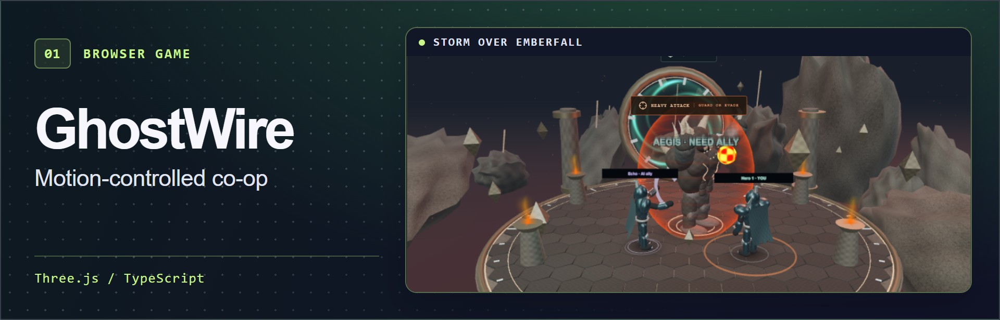
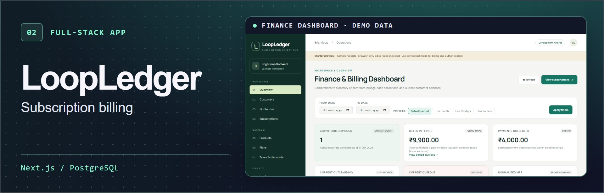
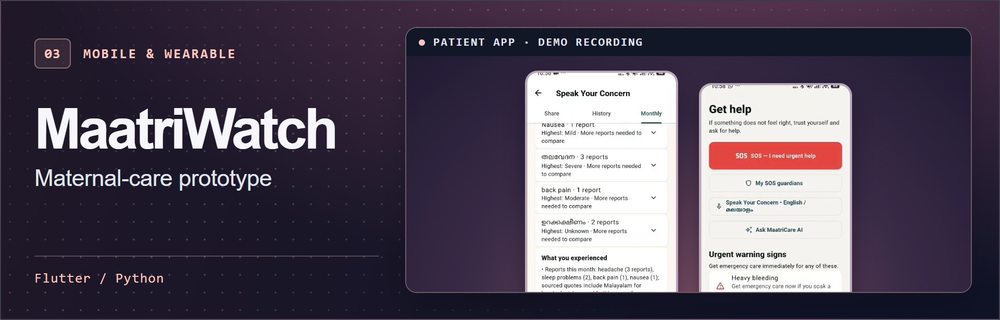
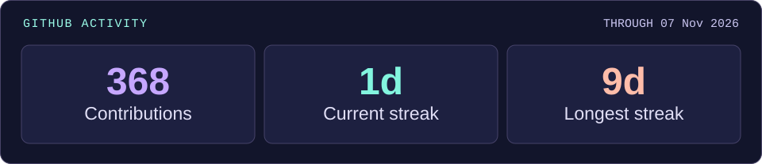

<p align="center">
  
</p>
<p align="center">
  
</p>
<p align="center">
  
</p>
<p align="center">
  <a href="https://github.com/Devadathan69"></a>
  <a href="https://github.com/Devadathan69?tab=repositories"></a>
  <a href="https://loopledger-demo.vercel.app/"></a>
</p>

## ⚡ About Me

I’m Devadathan. I build things people can try, from a demo that explains each line on an invoice to a boss raid you play with your webcam.

```typescript
const devadathan = {
  build: ["Web", "AI", "3D"],
  tools: ["React", "Flutter"],
  approach: "Build a demo first",
} as const
```

## 🛠️ Tech Stack

**Languages**  
   

**Web, Mobile & 3D**  
   

**Backend, Data & AI**  
    

**Tools & Testing**  
   

## 🎮 Featured Projects

<table width="100%">
  <tr><td>
    <a href="https://github.com/Devadathan69/GhostWire#demo-video">
      
    </a>
    <p>Control a hero with your movements and coordinate attacks with friends to break the boss’s shield.</p>
    <p><strong><a href="https://github.com/Devadathan69/GhostWire#demo-video">Watch gameplay ↗</a></strong> · <a href="https://github.com/Devadathan69/GhostWire">Source code</a></p>
  </td></tr>
</table>

<table width="100%">
  <tr><td>
    <a href="https://loopledger-demo.vercel.app/">
      
    </a>
    <p>Follow a quote through recurring invoices and payments, with a breakdown of how each charge was calculated.</p>
    <p><strong><a href="https://loopledger-demo.vercel.app/">Open the live demo ↗</a></strong> · <a href="https://github.com/Devadathan69/make-a-ton">Source code</a><br><sub>Demo sign-in required</sub></p>
  </td></tr>
</table>

<table width="100%">
  <tr><td>
    <a href="https://github.com/Devadathan69/MaatriWatch#product-demo">
      
    </a>
    <p>A team prototype that brings wearable readings and symptom notes into a clinician’s follow-up workflow.</p>
    <p><strong><a href="https://github.com/Devadathan69/MaatriWatch#product-demo">Watch the walkthrough ↗</a></strong> · <a href="https://github.com/Devadathan69/MaatriWatch">Source code</a></p>
  </td></tr>
</table>

## 📊 GitHub Statistics

<p align="center">
  
</p>
